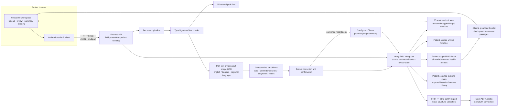

# MediPilot AI Architecture

Updated: 2026-10-11

## Runtime boundaries



```text
Browser
  React/Vite frontend (frontend/src)
    PatientWorkspace shell and hash-based authenticated navigation
    HealthOverview, HealthRecords, HealthJourneyPages
    Medications, DoctorAppointments, Reminders, supplied AnatomyViewer
    services/api.js sends requests to /api with the signed-in bearer token
          |
          | HTTP JSON / multipart; authenticated routes use protect middleware
          v
  Express backend (backend/src/server.js)
    dashboard, documents, health-records, appointments, medications,
    reminders, conversations, FHIR, ABHA, and sharing controllers
      |                         |                         |
      v                         v                         v
  MongoDB/Mongoose          private_uploads          configured Ollama
  user-scoped records        original PDF/images      report explanation/RAG
```

The frontend is React with Vite; it is not served as a Next.js application.
`frontend/src/app/components/AnatomyViewer.jsx` is an existing React component
consumed by the Vite application. Navigation fragments are browser URLs, not
separate server-side routes.

## Core document journey

1. An authenticated patient posts a PDF/JPEG/PNG to `POST /api/documents/upload`.
2. Upload middleware limits file size/type, the controller checks file
   signatures and duplicate content, and the original is stored under the
   backend's private upload directory.
3. Text PDFs use `pdf-parse`; images use Tesseract OCR with English or a
   selected English+Hindi/Telugu/Tamil language combination. Scanned PDFs are
   explicitly reported as unsupported. Handwritten recognition is best-effort.
4. Conservative extraction saves numeric lab result candidates into
   `Document.extractedData` and explicitly labelled diagnosis/date candidates
   into `Document.extractedClinicalData`. Prescription medicine suggestions
   remain separately reviewable. Source lines, confidence where available,
   and verification state are retained; clinical facts are not inferred from
   surrounding text.
5. The patient reviews/corrects extracted values via
   `PATCH /api/documents/:id/review`. A candidate is treated as confirmed only
   after the patient inspects the source and confirms or corrects it. Summary
   generation is rejected until the document is confirmed.
6. `POST /api/documents/:id/summarize` calls the existing Ollama explanation
   service and saves the generated explanation and selected language on the
   same patient-owned document.
7. `GET /api/documents/timeline` composes the saved documents, health notes,
   medications, lab reports, and confirmed/completed appointments for the
   signed-in patient. Lab reports linked to an uploaded source document are
   grouped into that document event, with identical values de-duplicated.

## Persistence and ownership

- `User` stores account identity and `preferredLanguage`.
- `Document` stores metadata, processing/review status, extracted source text,
  structured lab and clinical candidates, OCR language, and language-specific
  summary output.
- `HealthRecord`, `Medication`, `MedicationSuggestion`, `Appointment`,
  `AppointmentSuggestion`, and `Reminder` store their respective structured
  patient data.
- `ShareGrant` stores a hash of the random share token, selected record
  references, expiry/revocation, and a bounded access-event history.
- `HealthIdentity` stores an opaque patient identifier and a hash of its
  generation-specific QR token. `HealthAccessRequest` stores pending consent
  requests and hashes of their separate viewer tokens.
- Authenticated patient controllers derive ownership from `req.user.userId`.
  Frontend-provided patient IDs are not accepted as the authorization source.
- Original document retrieval is routed through an authenticated controller
  that verifies patient ownership before reading the private file.

## Connected features

- Appointment and medication status changes synchronize linked in-app
  reminders. Reminder completion is not a medication dose event, and no
  notification delivery or durable scheduler is configured.
- Copilot conversations are patient-owned; retrieval indexes all readable
  records scoped to the authenticated patient across uploaded documents,
  health records, labs, prescriptions and OCR suggestions, medications,
  appointments and suggestions, reminders, and nutrition data. Focused prompts
  retrieve relevant chunks; broad reviews use one passage each from up to 30
  sources and show an explicit partial-review warning when passages or sources
  are omitted. It never queries other patients' records or account/share
  credentials.
- Anatomy mapping uses a narrow list of supported region identifiers.
  A red marker requires a confirmed, patient-reviewed out-of-range result or
  explicit diagnosis text and a verified mapping. Diagnosis text is not
  clinician verification; unsupported or unreviewed content is not marked.
- FHIR export transforms selected patient records into a collection bundle
  and runs custom structural checks. Patient-reviewed diagnosis text maps to
  `Condition` resources with FHIR verification status `unconfirmed`; patient
  review confirms transcription only, not a clinician's diagnosis. It does
  not claim official profile validation or ABDM conformance.
- Direct patient sharing validates ownership and returns a random, expiring
  bearer link. The Health ID QR flow creates only a pending request when
  scanned; a patient must select records and approve an expiry before a
  `ShareGrant` is created. Both viewer and private-document endpoints enforce
  grant expiry/revocation. The Health ID professional viewer can generate an
  AI brief using only record IDs in its approved grant; it does not call the
  patient-wide RAG retrieval path. Requester identity remains unverified;
  neither feature is an ABDM consent integration. See
  [`ALTRIX_HEALTH_ID_IMPLEMENTATION.md`](./ALTRIX_HEALTH_ID_IMPLEMENTATION.md)
  for the implementation audit and production limitations.
- Cross-facility exchange is isolated fictional sample data, not a real
  exchange pathway.

## External services and configuration

- MongoDB connection is configured in the backend environment and must be
  checked locally. No database credential is part of the source tree.
- Ollama service/model configuration is required for AI explanation and
  supported Copilot generation.
- Password-reset email requires SMTP configuration in `backend/.env`; see
  [`../backend/PASSWORD_RESET_SETUP.md`](../backend/PASSWORD_RESET_SETUP.md).
- Real notification delivery, ABDM, clinic booking, identity-verified sharing,
  and production FHIR profile validation are not configured.

## Design constraints

Keep the existing MongoDB collections and authenticated APIs as the source of
truth. Do not introduce parallel browser persistence for patient records,
mark extracted suggestions as confirmed without user action, infer missing
clinical dates, treat AI text as documented facts, or present prototypes as
external healthcare integrations.
